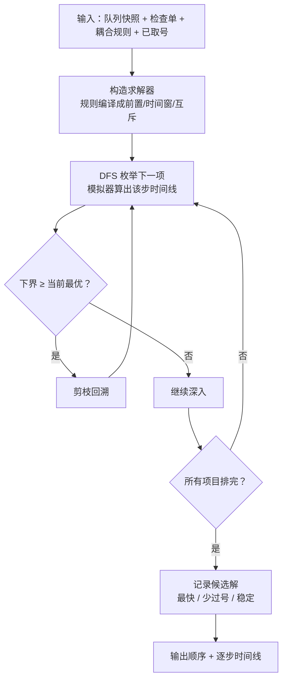

# 门诊多检查动态调度

> 患者手里一张检查单，5~8 项检查分散在不同科室。先去哪个、几点到，
> 直接决定他要在大厅耗掉一小时还是三小时。
>
> 这个项目做的事：**输入检查单 + 各科室实时队列，输出一条总耗时最短的检查路线**，
> 队列一变就自动重算。

**主要工作是调度算法的实现**——怎么建模、怎么搜索、号（挂号）怎么进入模型、怎么保证结果可信。
前端（`frontend/`）只是用来观察算法输出的界面，不是重点。

纯 Python 标准库，无第三方依赖。

---

## 1. 问题为什么难

1. **等待时长依赖到达时刻，而到达时刻又由顺序决定**——目标函数依赖它自己的输出，
   没法写成静态约束，CP-SAT 这类求解器直接用不上（见 [算法详解 §2](docs/调度算法实现.md)）。
2. **号把开始时刻钉死了**：挂了 30 号，就只能等叫到 30 号，早到只能干等；
   号过期还会作废。
3. **检查之间有耦合**：心脏彩超要先有心电图报告（还有 10 分钟出报告），
   生化要复用血常规那次采血，腹部B超只有上午的时间窗。

---

## 2. 算法总览

```
模拟器在环 + 分支限界（带可采纳下界）
```



每个节点用三件事剪枝：剩余服务时长总和、科室级下界 `W_D + Σs_i`、号的叫号时刻。
这三条都不会剪掉最优解，所以结果不只是"看起来不错"，而是可以给出最优性证书。

---

## 3. 实现路线（算法的三次迭代）

### 3.1 第一版：只排顺序

目标函数就是完成时间。搜索 + 下界 + 对拍验证，先把"排得对"这件事做实。
此时号还不存在，等待一律按队列消退估算。

### 3.2 第二版：号进入模型

号带来两个变化：

- **开始时刻被钉死**：`start = max(到达, 叫号时刻)`；赶不上就叫"过号"，改按现场重新取号排队；
- **顺序多了一条硬约束**：已挂号的项必须排在最前。

第二条的实现不是排序，而是**收缩搜索的候选池**：

```
还剩已挂号项 → 只能从已挂号项里挑下一项
已挂号项做完 → 放开全部剩余项
```

于是路线天然变成两段：`【已挂号块：组内最优】 +【未挂号块：组内最优】`。

### 3.3 第三版：块排不下时逐项降级

第二版有个副作用：块整体不可行就整块丢掉，路线看起来完全没变。
现在的做法是**只退必要的那一项**——先试"只退一项"，多个方案可行就取
"保留最多、总时长最短"的；一项都救不回来才继续退。

同时加了**前置闭包**：已挂号项依赖的前置没挂号（生化 ← 血常规），
把前置拉进块里一起排最前，而不是把已挂号项踢出去。

> 完整推导、流程图、代码位置见 **[docs/调度算法实现.md](docs/调度算法实现.md)**。

---

## 4. 关键设计一览

| 设计 | 做法 | 为什么 |
|---|---|---|
| 队列消退 | `wait(t) = max(0, W₀ − t)` | 患者在等的时候队列也在往前走，不算这条会高估 |
| 取号 | `call = (我的号 − 当前叫号) × 人均时长` | 号是硬承诺，只能按它算 |
| 过号 | 不判不可行，转"现场重取"并标注 | 真实医院就是让你去分诊台重取 |
| 下界 | `max(Σs, W_D+Σs_i, call+s)` | 可采纳，剪枝强，常直接等于最优 |
| 多解并存 | 最快 / 少过号（3 分钟内）/ 稳定（1 分钟内） | 时间为主，另外两个只在几乎不花代价时生效 |
| 块约束 | 候选池收缩 | 号是既成事实，不能让求解器把它排到过期 |
| 降级 | 逐项退，取保留最多的方案 | 避免"一项排不下，整条路线打散" |

---

## 5. 正确性怎么保证

- **暴力枚举对拍**：120 组随机算例（随机依赖、随机时间窗），与穷举所有排列的最优值逐一比对；
- **独立模拟器复核**：另写一套模拟逻辑重放求解结果，逐项核对时间与约束，并打印下界证书；
- **单元测试 21 项**：依赖、时间窗、缺前置、块前缀穷举最优、前置闸门等；
- **性能**：6 项 143 节点 / 3.9 ms；10 项 21,777 节点 / 100 ms；带 2 个号 10,820 节点 / 57 ms。

```bash
python -m unittest backend.tests.test_solver -v   # 21 项
python backend/tests/verify_example.py            # 独立验证 + 下界证书
```

---

## 6. 代码结构

```
backend/app/
├── solver.py         ← 算法核心：DFS + 分支限界 + 已挂号块 + 模拟
├── estimator.py      ← 队列消退、叫号时刻、等待估算
├── rules.py          ← 项目目录、耦合规则、可调参数（唯一业务配置）
├── service.py        ← 组装求解、逐项降级、生成说明
├── data_source.py    ← 队列数据源（HTTP 拉取 / 本地兜底）
├── prescriptions.py  ← 医嘱与挂号（演示用内存态）
└── server.py         ← HTTP 接口
frontend/             ← 单页界面（观察算法输出，非重点）
simulator/            ← 模拟叫号数据源（独立进程，端口 9000）
backend/tests/        ← 单测 + 独立验证脚本
docs/                 ← 算法详解与项目文档
```

---

## 7. 运行

```bash
# 终端 1：模拟医院叫号系统（端口 9000）
python -m simulator.queue_mock

# 终端 2：后端 + 前端（端口 8765）
python -m backend.app.server
# 浏览器打开 http://127.0.0.1:8765
```

不想起模拟器就加 `--local` 用内置队列数据。

---

## 8. 文档

| 文档 | 内容 |
|---|---|
| [docs/调度算法实现.md](docs/调度算法实现.md) | **算法详解**：建模、搜索、下界、号的约束、降级、踩坑记录 |
| [docs/研发文档-V2-20261104.md](docs/研发文档-V2-20261104.md) | 业务层改动：取号解耦、双端、挂号、块重排 |
| [docs/挂号逻辑对比与改造建议.md](docs/挂号逻辑对比与改造建议.md) | 与真实医院挂号流程的差异与改造清单 |
| [docs/研发计划-两个月排期.md](docs/研发计划-两个月排期.md) | 功能清单与两个月排期 |
| [DEPLOY.md](DEPLOY.md) | 服务器部署与运维 |

---

## 9. 已知限制

- 医嘱与挂号存在进程内存，重启即清空（演示限制）；
- 未取号时同科室两项仍可能被其他科室插队拆开，业务上应强制合并；
- 单患者视角，多患者共享队列的批量调度未实现。
