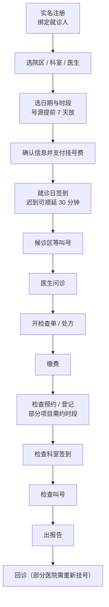
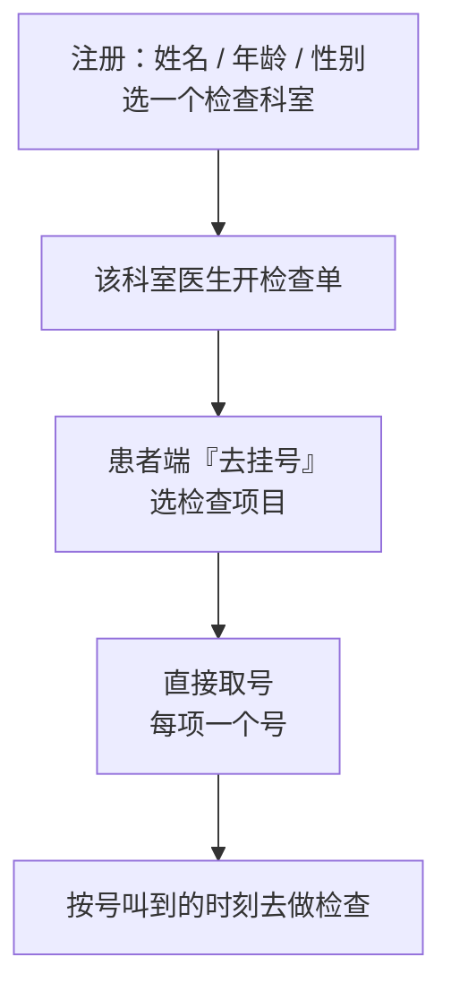
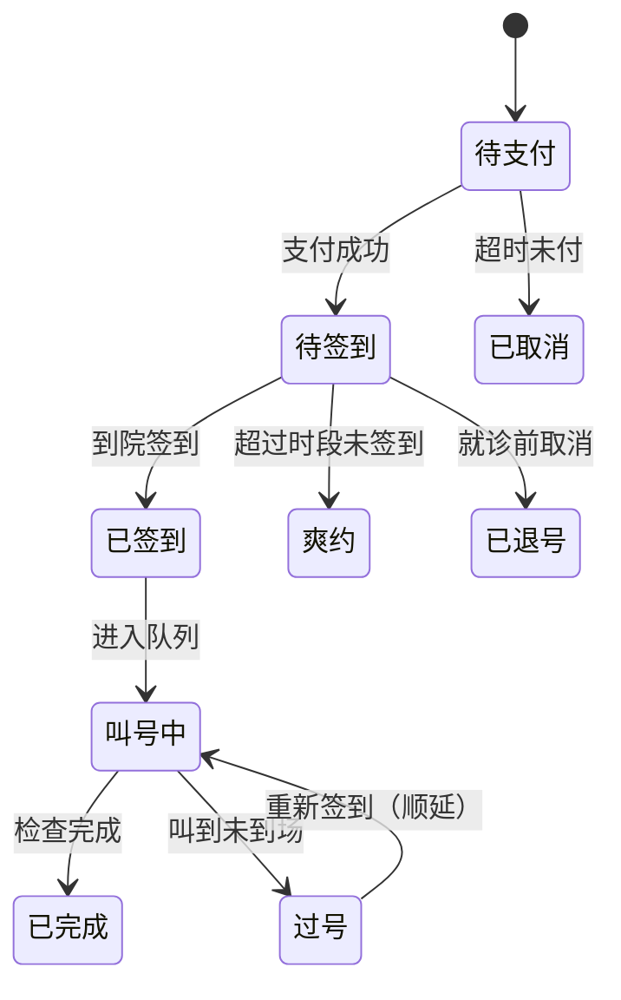
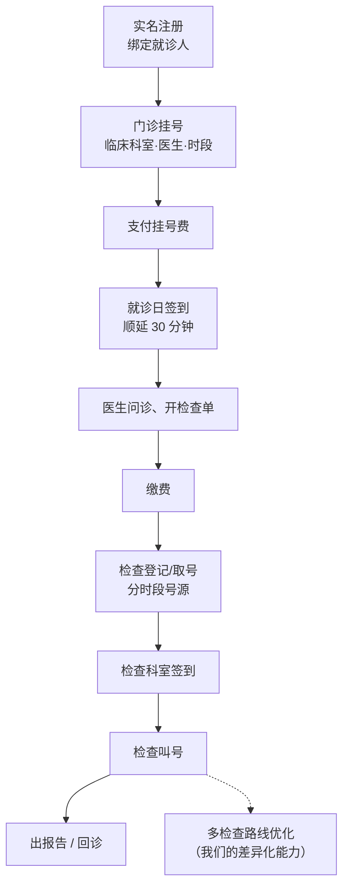

# 挂号逻辑对比与改造建议

> **对比对象**：西安交通大学第一附属医院（小程序 / 公众号「交大一附院患者服务」）为主，
> 横向参考武汉协和、安徽省立、大连大学附属中山医院等公开的预约挂号规则。
> **对比对象（我们）**：`http://120.55.205.30` 当前线上版本（`204b4e4`）。
> **结论提示**：最大的差距不是"少几个字段"，而是**我们把两件事做成了一件**——
> 真实医院是「门诊挂号（医生号源）→ 就诊开单 → 检查预约/取号（医技）」两层，
> 我们现在只有一层，而且叫"挂号"的其实是"检查取号"。

---

## 一、真实医院是怎么挂号的

### 1.1 完整链路

关键点：**挂号挂的是"医生 + 时段"，不是检查项目**。检查是就诊之后、缴费之后的另一套流程，
由医技科室（检验、超声、放射、心电）自己的预约/叫号系统管理。

### 1.2 交大一附院的核心规则

| 维度 | 规则 |
|---|---|
| 实名制 | 全程实名，凭身份证 / 电子就诊码 / 就诊卡就诊；首次需建档 |
| 号源投放 | 门诊号源 100% 放入预约池，**提前 7 天**开放，每日固定时点（公告为 8:00，部分渠道为 15:00）更新第 7 日号源 |
| 预约方式 | 小程序 / 公众号 / APP / 网站 / 自助机 / 人工窗口，多渠道同一号池 |
| 分时段 | 分时段预约，预约成功即占据就诊序号，按提示时段到院 |
| 签到 | 就诊当日到**相应科室自助机或手机签到**，号源保留 30 分钟，可顺延 30 分钟；超时视为自动放弃 |
| 退号 | 须在**就诊前一天**（部分公告为签到前）完成；逾期视为爽约 |
| 爽约 | **每月累计爽约 3 次，暂停一个月预约服务** |
| 费用 | 挂号费（诊查费）：早期"预约不收费、诊间扣除"，现公告为"预约时支付"，不同渠道/时期略有差异 |
| 出诊变更 | 医生停诊可协调同级别医师或改期，短信/电话通知 |

### 1.3 其他医院横向参考（说明这些是行业通用规则）

| 医院 | 规则要点 |
|---|---|
| 武汉协和 | 微信实名验证；**一次最多约 2 个科室、每科 1 名专家，一周最多 5 次**；分时预约；就诊前一日 16:30 前可在线取消，当日不接受线上退号 |
| 安徽省立 | 一个微信号最多绑定 **4 个就诊人**；可约次日起 6 天内号源；需即时支付；**半年累计爽约 3 次，取消预约资格 3 个月** |
| 大连大学附属中山医院 | 流程：就诊人管理 → 选科室 → 选日期 → 选医生 → **选时段** → 确认挂号；退号限就诊当日 7:00 前 |
| 合肥某区医院 | 同一账户**同一就诊日、同一科室只能预约一次**；当班有效，逾期作废 |

**共性**：实名 + 就诊人管理 + 医生号源 + 分时段 + 支付 + 签到 + 退号/爽约约束。
这六项几乎是所有医院小程序的标配，不是某家医院的特色。

---

## 二、我们现在的逻辑

| 维度 | 我们的现状 |
|---|---|
| 挂的是什么 | **检查项目**（血常规、腹部B超…），不是医生号 |
| 科室 | 5 个**检查科室**（检验/心电/超声/放射/呼吸），不是临床科室（内科/外科/儿科） |
| 号源 | 无上限，来一个发一个（`queue_mock` 顺序发号） |
| 时段 | 无；号即队列序，按叫号时间推进 |
| 实名 | 只有姓名/年龄/性别，无身份证、无手机号、无就诊人管理 |
| 费用 | 无挂号费、无检查费、无支付 |
| 签到 | **无**：取了号就默认你会来，号到点就叫 |
| 退号 | 无；号只能作废（过号后现场重取） |
| 爽约 | 无统计、无惩罚 |
| 医生 | 只有"开单医生"一个名字，没有排班、没有号源 |
| 特色 | 多检查**全局最优路线**、前置强制、已挂号块重排（真实医院没有） |

---

## 三、逐维度对比

| # | 维度 | 真实医院 | 我们的实现 | 差距 |
|---|---|---|---|---|
| 1 | 业务分层 | 门诊挂号 → 就诊 → 开单 → 缴费 → 检查预约 → 签到 → 叫号 | 注册选科室 → 开单 → 检查取号 | **根本性** |
| 2 | 挂号对象 | 医生 + 时段 | 检查项目 | **根本性** |
| 3 | 科室体系 | 临床科室（内/外/妇/儿）→ 医生 | 检查科室 | **根本性** |
| 4 | 号源 | 定量号池、提前 7 天、固定时点放号 | 无上限、随时可取 | 大 |
| 5 | 时段 | 分时段预约，按时段到院 | 无时段，按叫号序 | 大 |
| 6 | 实名 | 身份证/就诊卡/电子健康卡 | 姓名+年龄+性别 | 大 |
| 7 | 就诊人 | 一账号可绑 4–5 位家属 | 一人一档，无法代家人 | 大 |
| 8 | 支付 | 挂号费/检查费在线支付 | 无 | 大 |
| 9 | 签到 | 到院签到才进队列，可顺延 30 分钟 | 无签到 | **根本性** |
| 10 | 退号 | 就诊前一日线上取消 | 无 | 大 |
| 11 | 爽约 | 累计 3 次暂停预约 | 无 | 中 |
| 12 | 限号 | 同科室同日 1 次、每科 1 医生、周≤5 | 无限制 | 中 |
| 13 | 医生排班 | 有排班表、专家/普通号、停诊替诊 | 无 | 中 |
| 14 | 报告回诊 | 报告出具后回诊（可能需重新挂号） | 无报告环节 | 中 |
| 15 | 检查预约 | 缴费后到医技科室预约/登记 | 我们这一步做成了"挂号" | 概念错位 |

---

## 四、需要修改的地方（按优先级）

### P0：不改就不像真实业务

#### 1. 把"挂号"和"检查取号"拆成两层

- **现状**：患者端「去挂号」实际是在给检查项目取号，页面、接口、文案都叫挂号。
- **问题**：语义错位。真实医院挂的是医生号；检查是就诊后医技科室的预约/登记。
  现在患者"挂了 3 个检查的号"，在真实场景里对应的是"取了 3 个检查队列号"，不是挂号。
- **改法**：
  - 门诊侧新增「预约挂号」：选临床科室 → 选医生 → 选日期时段 → 支付 → 生成挂号单；
  - 现有挂号页改名为「检查登记 / 取号」，归属于医技侧，只对已开单患者开放；
  - 页面文案、接口命名（`/tickets` → `/check-tickets`）、数据表同步调整。
- **影响**：`prescriptions.py`、`server.py`、前端路由与文案。

#### 2. 引入"签到"，号 ≠ 到场

- **现状**：取了号就默认患者会来，叫到就做；过号才转"现场重取"。
- **问题**：真实医院必须**到院签到**才进入叫号队列，未签到直接作废或记爽约；
  签到后迟到还可顺延 30 分钟。我们的模型没有"人到没到"这个状态。
- **改法**：号的完整状态机（见下图）；签到接口（自助机/手机扫码）；
  未签到不计入队列；签到迟到按"顺延 N 位"处理。
- **影响**：队列模型、状态字段、签到接口、求解器对"未签到"的处理。

#### 3. 号源与时段：从"无限取号"改成"定量号池"

- **现状**：来一个发一个，号是连续流水；没有上限，也没有时段。
- **问题**：真实医院每个科室/医生每天号源有限，按时段投放；检查侧也有每日预约量上限
  （超声、CT 尤其明显）。
- **改法**：为每个检查项目配置"每日号源 + 时段粒度"（如每 15 分钟 3 个），约满即止；
  号绑定具体时段，签到时间窗由时段决定。
- **影响**：新增号源表；取号接口增加余量校验；排队估算改为按时段聚合。

#### 4. 实名制与就诊人管理

- **现状**：姓名/年龄/性别，一人一档，无法给家人挂号。
- **问题**：真实医院全程实名，一个账号可绑定多位就诊人（4–5 位），凭身份证/就诊卡/电子健康卡就诊。
- **改法**：增加身份证号、手机号字段与校验；一个账号下挂多个就诊人；
  就诊人切换后，挂号/检查/报告都按就诊人维度查询。
- **影响**：`Patient` 模型、注册接口、前端就诊人选择。

#### 5. 费用与支付

- **现状**：无任何费用。
- **问题**：真实挂号要付挂号费（诊查费），检查要先缴费才能预约/登记。
- **改法**：增加挂号费、检查费字段与"待支付/已支付"状态；未支付不生效；
  演示环境可用模拟支付（点击即成功），不接真实支付渠道。
- **影响**：订单模型、状态机、页面。

#### 6. 退号与爽约规则

- **现状**：无退号，号过期即作废。
- **问题**：真实医院允许就诊前一天线上退号；逾期未签到记爽约，累计 3 次暂停预约。
- **改法**：退号接口（带时限校验）；爽约计数与限制策略；页面上展示剩余可约次数。
- **影响**：状态机、统计、权限校验。

### P1：补齐体验与合规

| # | 改动 | 说明 |
|---|---|---|
| 7 | 放号规则 | 提前 7 天、每日固定时点放号；号源 100% 进预约池 |
| 8 | 挂号数量限制 | 同科室同日 1 次、每科 1 名医生、每周上限（参考协和 5 次） |
| 9 | 医生与排班 | 增加医生、职称（专家/普通）、排班表、停诊替诊；挂号挂到"医生+时段" |
| 10 | 报告与回诊 | 检查报告出具后提醒；回诊是否需要重新挂号按医院规则配置 |
| 11 | 检查预约与缴费联动 | 开单 → 缴费 → 才能检查登记；未缴费的检查单不进入队列 |

### P2：可延后（演示可简化）

- 医保支付、电子健康卡、短信通知、电子发票、多院区、停车/导航等。

---

## 五、改造后的目标流程

其中 **K 是我们相对真实医院的优势**：真实医院的小程序里，检查是分散预约的，
没有跨科室的全局最优路线。改造时要把这条能力保留在"检查登记之后"，不要为了像挂号而丢掉。

---

## 六、落地建议

| 步骤 | 内容 | 工作量 |
|---|---|---|
| 第一步 | 概念拆分：门诊挂号 / 检查登记两套入口与文案 | 3–4 天 |
| 第二步 | 号状态机 + 签到（含顺延 30 分钟） | 3–4 天 |
| 第三步 | 号源与时段（定量号池、约满即止） | 4–5 天 |
| 第四步 | 实名与就诊人管理 | 2–3 天 |
| 第五步 | 费用与支付（模拟） | 2–3 天 |
| 第六步 | 退号 / 爽约 / 限号 | 2–3 天 |
| 第七步 | 医生排班与专家号（可选，视演示需要） | 4–5 天 |

前六步约 3 周，可以嵌进现有两个月排期的「阶段三、四」之间，不影响已经做好的调度内核。

---

## 七、一句话总结

我们现在的"挂号"本质是**检查排队取号**，而真实医院的挂号是**约医生和时段**；
差距集中在「两层业务没拆开、没有签到、号源不设上限、没有实名/支付/退号爽约」五处。
其中**签到**和**两层拆分**是必须改的，其余可以按演示需要逐步补齐；
而多检查全局最优路线是我们的独有能力，改造时要保留。

---

## 参考来源

- 西安交通大学第一附属医院《预约方式查询》：<https://www.jdyfy.com/gzbsy/hzfw/yyfscx.htm>
- 交大一附院患者服务平台《就诊指南》《全部挂号途径整理》（微信公众号）
- 武汉协和医院微信预约挂号须知（好大夫在线转载）
- 安徽省立医院微信就医指南（好大夫在线转载）
- 大连大学附属中山医院《预约挂号》流程说明
- 合肥市某区医院《预约挂号须知》（政府公开页）

---

## 八、待确认的逻辑问题（待处理）

> 下面这些点，真实医院之间做法不一致，或者和我们"检查调度"的定位存在冲突。
> **改造前需要逐条拍板**，否则容易按某一家医院的规则写死，后面返工。

### 1. 系统定位：做完整门诊挂号，还是只做医技检查调度？

真实医院是"门诊挂号 + 医技预约"两套系统。我们要不要自己做门诊挂号（医生排班、号池、支付），
还是把门诊挂号当作上游系统、只接收"已开单"的结果？
**影响**：决定了 P0 第 1 条要不要做，工作量差一倍以上。
**暂定**：先按"只做检查侧"设计，门诊挂号留接口。

### 2. 所有检查项目都要限量吗？

真实医院里，检验科多为现场自助取号（几乎不限量），超声/CT/MRI 才是严格预约制。
我们现在对所有项目统一"取号"。
**不确定**：哪些项目该走预约、哪些走排队。
**暂定**：按项目配置两种模式（预约制 / 排队制），检验类默认排队制。

### 3. 签到是必须的吗？什么时候签？

真实医院要求就诊日签到才进队列。但我们是"路线规划"，患者可能还没到院就要看路线；
如果强制签到，签到前就无法生成路线。
**暂定**：区分"预约态"（按号估算，可看路线）和"到院态"（签到后按实际队列重算），
两个态都给结果，只是精度不同。

### 4. 号池和现有的叫号模型能不能兼容？

现在的算法假设"号是连续流水号"，`叫号时刻 = 号差 × 人均服务时长`。
一旦改成"每 15 分钟放 3 个号"的时段号池，号差不再等于人数差。
**影响**：`estimator` 的核心公式，属于算法层改动。
**暂定**：号池方案下改用"时段中点 + 队列位置"估算，保留现有公式作为排队制的口径。

### 5. 迟到顺延的具体规则

各医院不同：有的顺延 30 分钟，有的排到当前队尾，有的延后 3 位。
**暂定**：先做"顺延 30 分钟"且可配置，观察是否够用。

### 6. 退掉的号要不要回到号池？

真实系统一般会回收再放。回收涉及并发（两个人同时抢最后一个号）。
**暂定**：演示阶段退号只置状态、不回流；上线前再补回流与并发控制。

### 7. 爽约怎么算、算在谁头上？

未签到算爽约？过号算不算？3 次的口径是按就诊人还是按账号？
**暂定**：未签到记爽约，过号不计（现场重取即可）；按就诊人累计。

### 8. 费用要不要真实金额？

演示是否需要显示"挂号费 ¥15 / 检查费 ¥XXX"，还是只做"待支付/已支付"状态。
接医保会让复杂度陡增。
**暂定**：只做状态 + 假金额展示，不接支付渠道和医保。

### 9. 报告与回诊要不要做？

真实医院看报告常需回诊，有的给免费回诊号、有的要重新挂号，规则不一。
我们目前完全没有报告环节。
**暂定**：先不做，等确认演示范围。

### 10. "前置检查必须先挂号"这条要不要保留？

这是我们为了路线可行性加的业务规则，真实医院不会在挂号环节卡前置
（患者可能在外院已经做过血常规）。
**不确定**：是否与真实流程冲突。
**暂定**：保留，但增加"已完成/外院已做"标记，可豁免。

### 11. 时间模型要不要支持跨天？

现在是固定的当日快照（09:05），而真实号源提前 7 天、按时段分布。
**影响**：现有模型只有"距当日 0 点的分钟数"，跨天要加日期维度，属于数据模型级改动。
**暂定**：演示阶段不跨天；上线前重做时间模型。

### 12. 一次挂号的限制要不要照搬？

协和是"2 个科室、每科 1 名专家、一周 5 次"，其他医院各不相同，未必都适合我们。
**暂定**：不做硬限制，先观察真实使用数据再定。

