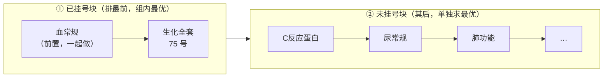
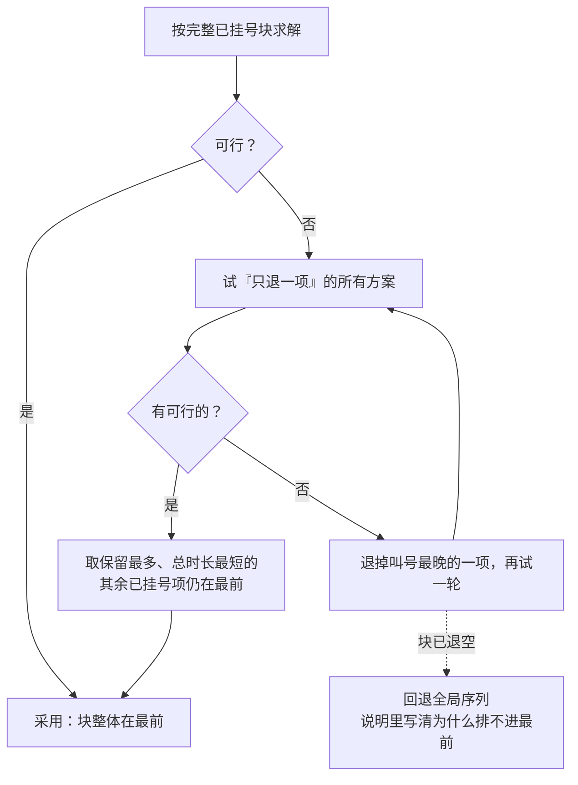
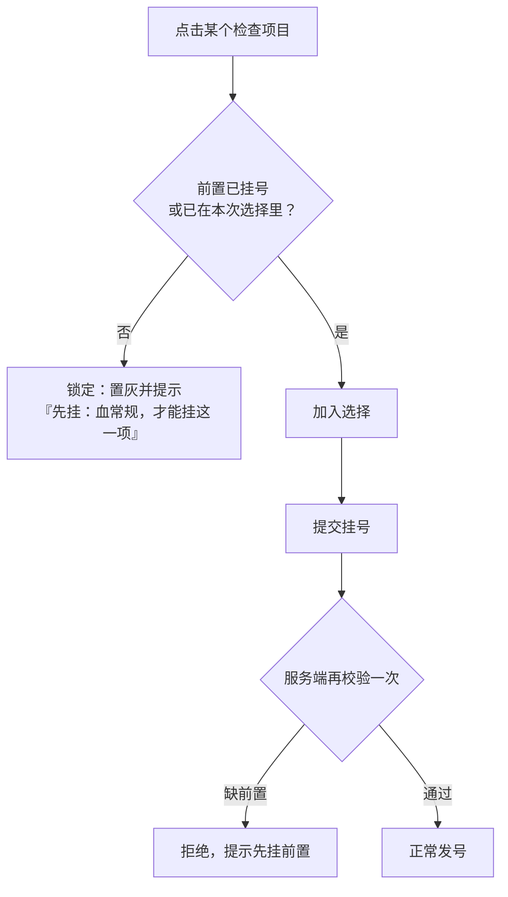

# 系统改动说明（V1 → V2）

> 基线是 11-01 的版本：一个单页演示，**点一下检查项目就等于取号**，然后给出最省时的顺序。
> 今天的改造围绕一件事展开：**号（挂号）是既成事实**，路线必须围着号走，而不是反过来。
> 下面按改动点逐条说明每处改动解决了什么问题、有什么实际意义，复杂的地方配图。

---

## 1. 取号与检查解耦：医嘱 → 挂号 → 按号做检查，三步分离

**以前的问题**：患者点一个项目就自动取了号——他可能只是想看看"做这些检查大概要多久"，
结果号已经排上了；等路线排出来发现有两项根本不用做，或者想换个顺序，号却已经作废了。
看路线这个动作本身，不应该产生任何排队后果。

**现在的做法**：把三件事彻底拆开。医生开单只说明"要做哪些检查"；挂号是独立的一步，
患者自己决定给哪几项取号、什么时候取；检查则按号被叫到的时刻去做。路线页输出的是
**预估时间轴**（几点到、大概等多久、几点做完），它只是参考，不影响挂号；一旦取了号，
对应那项的开始时刻就被号钉死，不再随队列估算浮动。

**实际意义**：患者不会"为了看路线白取一个号"，也不会因为中途改主意而浪费号；
取不取号、取几个、先取哪个，全由患者掌控。


---

## 2. 挂号顺序由患者自己定，偏离推荐只提醒、不拦截

**以前的问题**：系统给的推荐顺序是"最省时"的，但患者有自己的实际情况——
可能某个科室顺路、可能家人在那边等着、可能就是不想先做某一项。强制按推荐走不现实。

**现在的做法**：患者在挂号页可以按任何顺序、任意组合挂号，点击的先后就是挂号顺序。
只有当选择偏离推荐顺序时弹一次确认，说清"推荐先挂哪一项、您跳过了哪几项"，
**确认后完全按患者的选择重排路线**，不会判不可行、也不会偷偷改回去。

**实际意义**：系统尊重患者的自主权，同时保证他清楚偏离的代价；路线永远跟着真实选择走，
而不是停在旧推荐上不动。

---

## 3. 患者不自选检查：医生开单，患者按医嘱执行（双端分离）

**以前的问题**：患者自己勾选检查项目，容易多勾、漏勾，也不符合真实就诊流程——
检查本来就是医生根据病情开的。

**现在的做法**：拆成医生端和患者端两个入口。医生在自己科室的页面里给患者开检查单
（可以开本院其他科室的项目，如心电图、CT）；患者端只显示"医生开具的检查"，
不能自选，只能按这份医嘱去挂号、排路线。跨科室开单在服务端直接拒绝（403），
不是靠界面上藏起来。

**实际意义**：贴近真实门诊流程，避免患者做不需要的检查；责任边界清楚——
做什么由医生定，什么时候做、先做哪个由患者定。


---

## 4. 患者先选科室挂号，医生按科室分页面

**以前的问题**：只有一个大列表，患者和医生都挤在一起，看不出"这个患者是挂哪个科的"。

**现在的做法**：挂号时先选科室（检验科 / 心电科 / 超声科 / 放射科 / 呼吸科），
生成带科室前缀的就诊号（如"检验科 J003"）。医生端每个科室一个独立页面
（`/doctor/lab`、`/doctor/ecg`…），只显示挂在本科室的患者，服务端按科室隔离。

**实际意义**：对应真实门诊的分科就诊；医生看到的工作台就是自己的诊室队列，
不会被其他科室的患者干扰。

---

## 5. 挂号后路线重排：已挂号的排最前，未挂号的在其后重新优化

**以前的问题**：挂了号之后路线不动，或者只弹个提示，患者已经拿到手的号被排到后面去作废。

**现在的做法**：挂号后路线立刻重排，规则是两段拼接——

```
路线 = 【已挂号块：块内重新求最优】 + 【未挂号块：从上一块结束起单独求最优】
```

只挂一个号，它就排第一；一次挂多个（不管顺序是否和推荐一致、也不管是不是做到一半才去挂），
这几个已挂号项先在块内互相排一次最优，整体放最前，没挂号的再单独排一次接在后面。
两段不互相插队。

**实际意义**：号是排队凭证，拿到了就不能浪费；同时块内部仍然经过最优排序，
不是简单按挂号先后硬排。患者一眼能看出"我挂过号的都在前面"。



---

## 6. 排不下时只退必要的那一项，不把整条路线打散

**以前的问题**：只要已挂号的几项"整体排不下"，就把整块丢掉退回全局最优。
比如患者挂了生化和腹部B超，但腹部B超的号要到 10:41 才叫到，排最前会让肺功能错过
11:00 的关门时间——于是整块被丢弃，路线看起来完全没变，患者以为功能没生效。

**现在的做法**：一项一项地试。先试"只把其中一项退到后面"能不能排下，多个方案可行就取
"保留项最多、总时长最短"的那个；一项都救不回来才退叫号最晚的那项再试。
退到最后一项都排不下，才回退全局，并在说明里写清原因。说明**如实反映结果**：
赶得上号写"已安排在 10:41 前后"，赶不上写"届时号已过、需现场重取"。

**实际意义**：最大限度保住患者手里的号；退让是精准的、可解释的，不是一刀切。
系统宁可把代价说清楚，也不假装"都安排好了"。



---

## 7. 前置检查必须先挂号，否则依赖它的项目不许挂

**以前的问题**：生化全套要复用血常规那一次采血，心脏彩超要先有心电图结果。
患者只挂了生化的号，血常规没挂号——号拿了也做不了，等到排路线时才发现。

**现在的做法**：把这个约束提到挂号环节。前置没挂号、也没在本次选择里的项目，
在挂号页直接锁定（置灰 + "先挂：血常规，才能挂这一项"），点了也不勾选；
取消血常规时，依赖它的生化一并取消。即使绕过前端直接调接口，服务端也会校验并拒绝。

**实际意义**：把"挂了号却做不了"这种无效排队提前拦住；患者在挂号的那一刻
就被告知正确顺序，而不是白跑一趟之后才知道。



**当前的前置关系**（在规则库里配置）：生化全套 / C反应蛋白 / 支原体抗体 ← 血常规；心脏彩超 ← 心电图。

---

## 8. 等待空档里提醒顺路取号

**以前的问题**：患者在 A 科室排队 40 分钟干等，B 科室的号还得做完 A 再跑一趟取。

**现在的做法**：如果"等 A 的剩余时间 + 往返一趟"不超过"B 科室当前的排队时间"，
就在路线里提示"可以顺路去 B 把号取了，回来仍赶得上"。同科室不提醒（做完顺手取即可）。

**实际意义**：少跑一趟冤枉路，把排队的死时间利用起来。

---

## 9. 其他调整

- **等待时间分两种口径**：没取号按队列估算（略保守，×1.15），取了号按"号差 × 人均时长"精确算，
  页面上标注来源，避免把估算当成精确承诺。
- **界面可感知变化**：路线标题旁标"已挂号 N 项排在最前"，步骤列表分"已挂号 / 未挂号"两段，
  静态资源带版本号 + 页脚 build 标记——改动一眼能看出生效，也方便确认浏览器是不是在跑旧代码。

---

## 遗留问题

1. 医嘱、挂号存在进程内存里，重启即清空（演示限制，接真实系统时需落库）；
2. 未取号时同科室的两项检查仍可能被其他科室插队拆开，业务上应强制合并，待改；
3. 号叫得特别晚时只能排到后面甚至作废——目前靠事后说明，下一步可在**挂号时就预警**。
