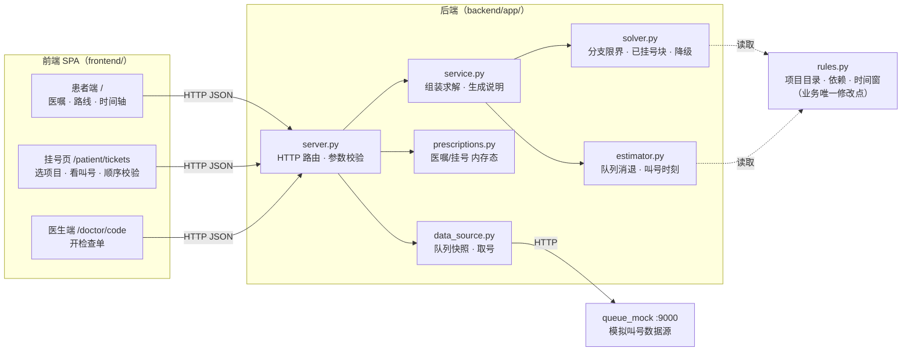
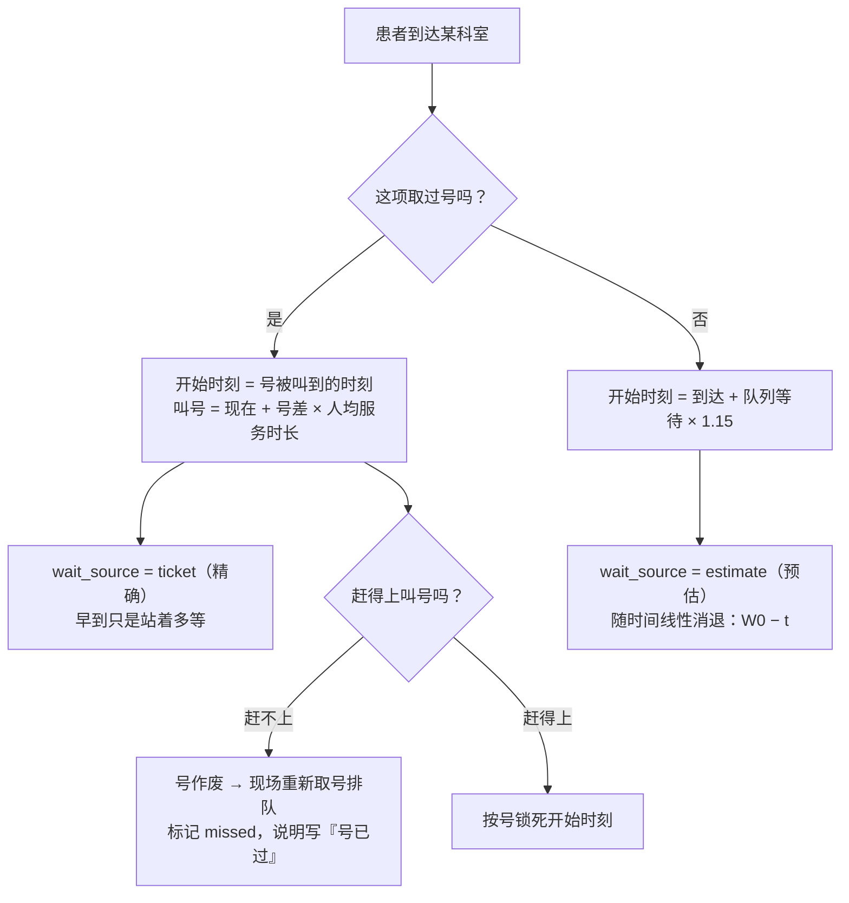
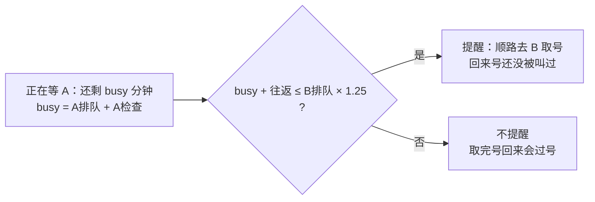
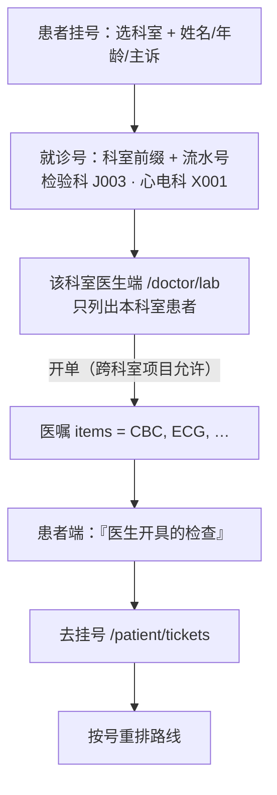
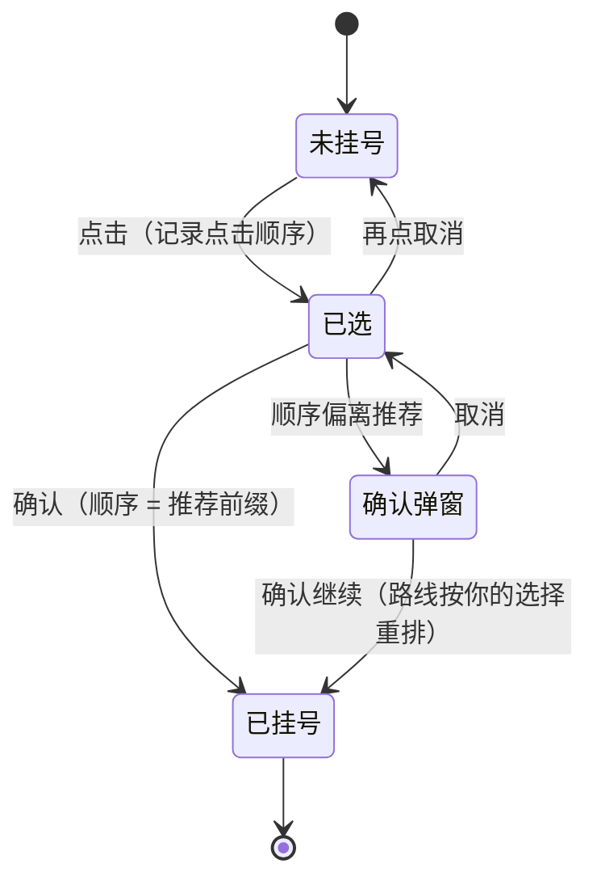
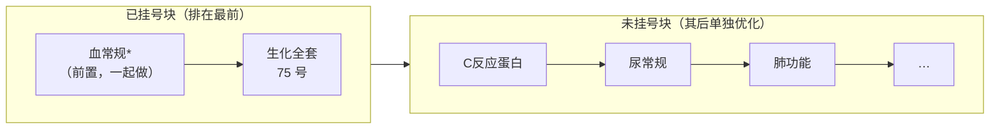
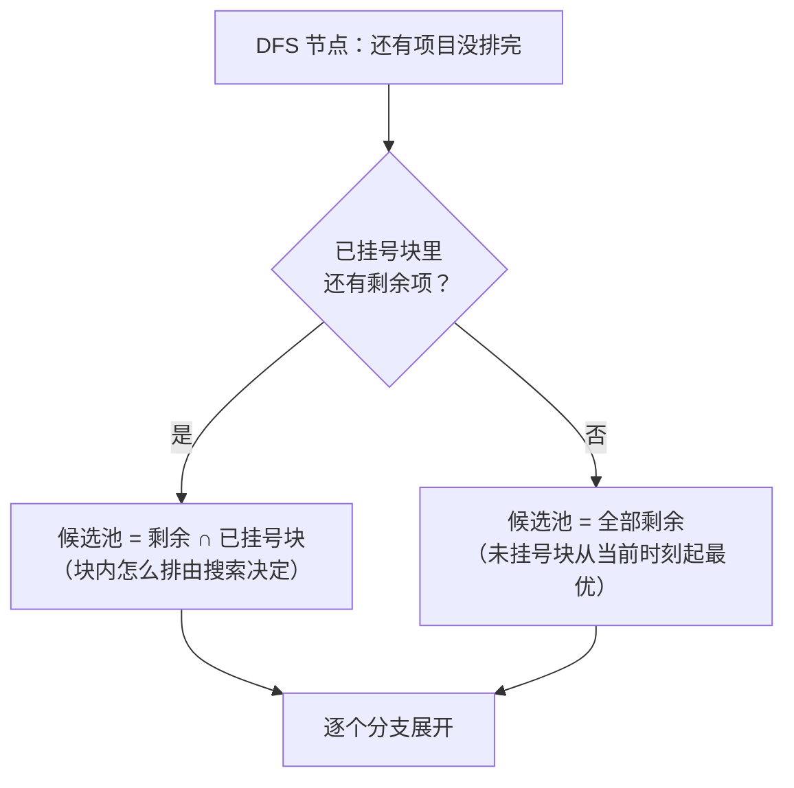
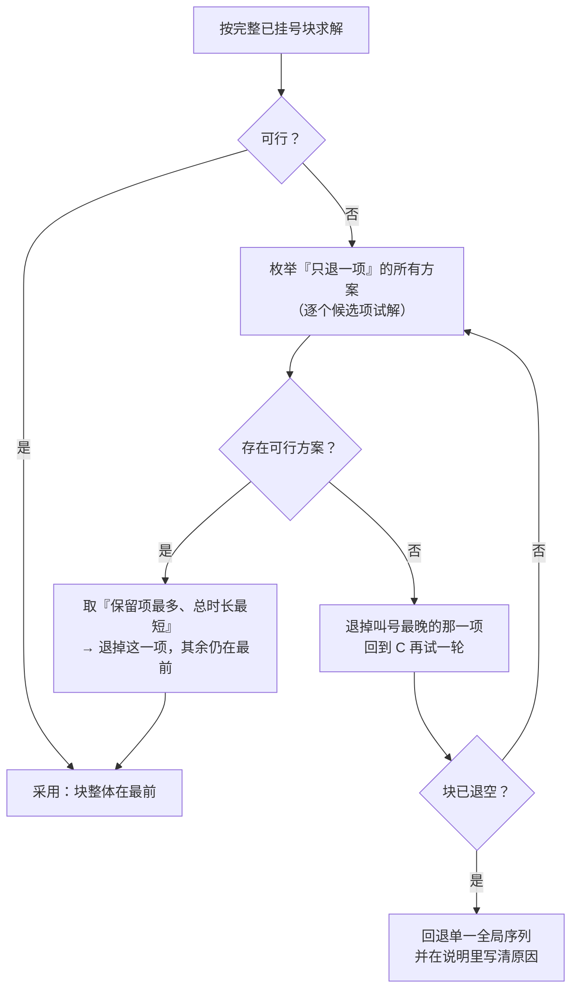
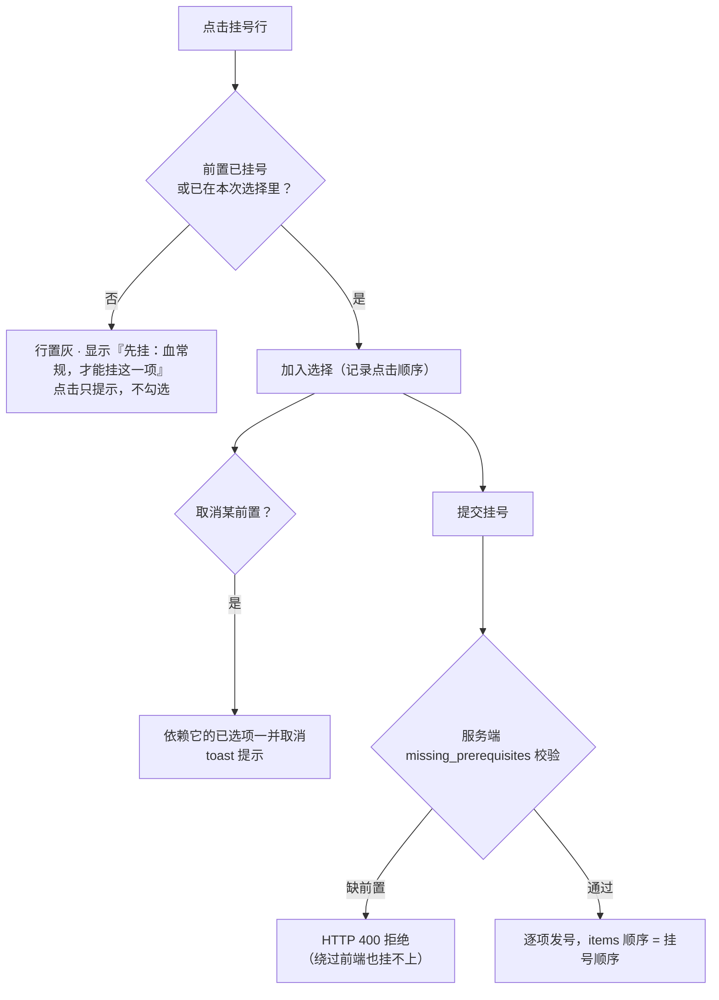

# 门诊检查路线规划系统 · 研发文档（V1 → V2）

> **基线版本**：2026-11-01（V1，"点项目 = 直接取号"的单页演示）
> **目标版本**：2026-11-04 当日全部改动（V2，共 16 个提交，`06e763e … 204b4e4`）
> **读者**：后续接手的开发者 / 需要复盘设计取舍的评审者
> **代码**：`exam_scheduler/`（后端 `backend/app/`、前端 `frontend/`、规则库 `backend/app/rules.py`）

---

## 1. 一句话总结

V1 只解决"给一组检查排出最省时的顺序"；V2 把**号（挂号）作为既成事实**引入模型，
围绕它重排路线，并把"取号"与"做检查"彻底解耦。核心变化是三条规则：

1. **号决定路线结构**：已挂号的项目排在最前（块内重新求最优），未挂号的接在后面单独求最优；
2. **排不下只退一项**：某项号太晚会挤掉别人时间窗时，逐项降级，不再整条打散；
3. **前置强制**：前置检查没挂号，依赖它的项目在挂号页直接锁死，前后端双重拦截。

---

## 2. V1 → V2 对照总览

| 维度 | V1（11-01 基线） | V2（今日） |
|---|---|---|
| 取号语义 | 点项目 = 直接取号 | **取号与检查解耦**：医嘱→挂号→按号做检查，三步分离 |
| 输出 | 最优顺序 + 时间轴 | 最优顺序 + **预估时间轴**（等待双口径）+ 取号提醒 |
| 角色 | 单页患者端 | **医生端开单 + 患者端执行**，服务端科室隔离 |
| 科室 | 无概念 | 患者先**选科室挂号**，医生按科室独立页面（`/doctor/<code>`） |
| 号与路线 | 号只影响等待 | 号**硬约束路线结构**（已挂号块在前） |
| 不遵从推荐 | 无 | 前缀判定 + 弹窗确认 + 事后重排 |
| 前置依赖 | 只影响顺序 | 影响**能否挂号**（强制先挂前置） |
| 前端版本 | 无版本管理 | 静态资源 `?v=` 版本号 + 页脚 `build` 标记 |
| 单测 | 13 项 | 21 项（+块前缀穷举对拍、+前置闸门） |

**今日提交清单**（时间序）：

| 提交 | 内容 |
|---|---|
| `06e763e` | 取号与检查解耦，新增医生端/患者端双视图 |
| `b59ae47` | 同科室合并一次到场，双端文档 |
| `78f71e6` | 时间轴图例类名修复、窄段序号标注 |
| `2193dcb` | bundle 同步说明（GitHub 故障期） |
| `f4c4513` | 患者选科室挂号，医生按科室分页 + 服务端隔离 |
| `4fffedd` | 时间轴每段带步骤序号 |
| `aab62d4` | 取号提醒改为醒目提示条 |
| `fa38beb` | 挂号流程（每项一个号）+ 顺序校验 |
| `5f0346a`/`1274ba7` | 顺序校验改**前缀判定** + 「建议先挂」标记 |
| `323f369` | 已挂号项硬约束排最前（第一版） |
| `9a2caa7` | 静态资源版本号 + 「已按挂号重排」徽标 + build 标记 |
| `e939ce2` | 重排改为**块内最优 + 块后最优**，前端分段展示 |
| `2afb0ca`/`7042c11` | **逐项降级** + 前置拉入块 + 如实说明 |
| `204b4e4` | **挂号强制前置**（前端锁定 + 服务端闸门） |

---

## 3. 需求演进（为什么这么做）

用户共提出 6 轮需求，每轮都改变了模型边界：

1. **取号与检查解耦** —— 点项目只是表达意图，输出预估时间轴；
2. **提醒取号** —— 等待空档里提醒"顺路去取号"；
3. **医生开单** —— 患者不自选项目，双端分离；
4. **不遵从推荐时重规划** —— 挂号顺序可以偏离，路线要跟着变；
5. **科室划分** —— 患者先挂科室，医生只看本科室患者；
6. **挂号强制前置** —— 前置没挂号，依赖项根本不许选。

设计上始终遵循一条原则：**号是既成事实**。它要么被尊重（排最前、按叫号时刻开始），
要么被明确作废（"号已过 · 现场重取"），不允许含糊。

---

## 4. 系统架构



要点：
- **规则库只有一处**（`rules.py`）：项目、依赖、时间窗、参数，业务人员改完即生效；
- **队列是外部输入**：`queue_mock` 只提供"排队人数 / 等待 / 当前叫号 / 人均时长"，
  换成真实 HIS 接口时只改 `data_source.py`；
- **医嘱/挂号是内存态**（`prescriptions.py`），进程重启即重置（演示限制，见 §10）。

---

## 5. 核心改动详解

### 5.1 取号与检查解耦（时间口径是本改动的根基）

V1 里"点项目"就取号，等待只有一个口径。V2 把取号单独走一条流程，等待因此**分裂成两种口径**：



**为什么估算要 ×1.15（`ESTIMATE_BUFFER`）**：队列消退模型给出的是理论值，真实到达可能略长。
展示值整体上浮 15% 降低过号概率；判断"来不来得及取号"用更保守的 `REMIND_BUFFER = 1.25`。

**移动耗时**：换科室计 `TRAVEL_MINUTES = 4` 分钟，同科室连续两项视为一次到场（一次采血做血常规+生化）。

**取号提醒判据**（图解）：



同科室不提醒（做完顺手取）；一步只提醒一项，避免刷屏。

---

### 5.2 双端与科室隔离



**隔离在服务端做**：`/api/doctor/<code>/patients` 只返回该科室患者；
医生开单时校验 `dept_code`，跨科室开单直接 `403`。前端拿不到其他科室数据，
不是靠界面隐藏。

---

### 5.3 挂号流程与顺序校验

- 每个检查项目一个号；一次可挂多个，**点击先后就是挂号顺序**；
- 挂号页每项显示：推荐次序、当前叫到几号、排队人数/等待、现在取号会拿到几号、约多久被叫到；
- 顺序校验用**前缀判定**：必须从推荐顺序的第一项开始按顺序挂。
  只挂第 2 项、跳着挂第 1 和第 3 项都算偏离（号是按时序发的，跳号会让后面的号过早被叫到）。



偏离时弹窗说清两件事：推荐先挂哪一项、你跳过了哪几项；确认后**按你的选择重排路线**，
而不是判不可行。

---

### 5.4 已挂号块重排（V2 最核心的语义）

挂号完成后路线重排的规则：

```
路线 = 【已挂号块：块内重新求最优】 + 【未挂号块：从上一块结束起单独求最优】
```


（`*` = 未挂号但被拉进块的前置，见 §5.6）

**只挂一个号**：该项排第一，其余在其后重新排最优。
**挂多个号**（不论与推荐是否一致、是否做到一半又去挂）：这几个已挂号项在块内互相排一次最优，整体放最前。

**实现要点**（`solver.py`）：求解仍是同一个 DFS + 分支限界，只是**候选池会收缩**：



块前缀性质由构造保证，接口返回 `ticket_block_size`（前 N 步属于已挂号块），
前端据此分段展示「已挂号 N 项 / 未挂号 N 项」。

---

### 5.5 排不下时逐项降级（`solve_with_best_block`）

问题场景：用户挂了 7（生化）、9（腹部B超），但腹部B超的号 10:41 才叫到，
排最前会让肺功能（11:00 关门）今天做不了 —— 整块不可行。
**V2 第一版的错误做法**是"整块丢掉退回全局"，结果路线完全不动，用户以为功能没生效。

正确做法：**只退必要的那几项**。



两个细节：
- **降级以"挂号项"为单位**，不是块内任意项 —— 退掉一项后，只为它服务的前置一并退出块，
  避免"前置孤零零排最前、挂号项却被挤到后面"；
- **说明如实反映结果**：赶得上号写"已安排在 HH:MM 前后"；赶不上写"届时号已过、需现场重取"。

线上实测（挂 7、9）：

```
1. 血常规（前置）  2. 生化全套 75 号  3~7 其余项目  8. 腹部B超 80 号（过号，现场重取）
说明：「腹部B超」（80 号，约 10:41 叫到）排在最前会占掉其他检查的时间窗，
     只能排到 11:25 之后，届时号已过、需现场重新取号
```

---

### 5.6 前置闭包拉入（`split_ticket_block`）

生化全套依赖血常规（共用一次采血）。若只挂了生化的号，血常规没挂号：
V2 第一版把生化踢出已挂号块（结果路线不动）；现在**把血常规拉进块里一起排最前**。


- 只拉"单子内还没做"的前置；已完成的前置（`completed`）不参与；
- 界面标注「另有 1 项前置一起做」，该项本身标"待取号"；
- 依赖环不会死循环（闭包按集合收敛）。

---

### 5.7 挂号强制前置（今日最后一项）

既然前置必须先做，就应该在**挂号环节**就拦住，而不是等排路线时再补救。
三层拦截：



**依赖关系来自 `rules.py`**（只列单子内的项）：

| 被锁定项 | 必须先挂 |
|---|---|
| 生化全套 / C反应蛋白 / 支原体抗体 | 血常规 |
| 心脏彩超 | 心电图 |

接口为每项返回 `requires`（全部前置）与 `requires_open`（尚未挂号的前置），前端据此锁定。

---

### 5.8 前端可用性修补

| 问题 | 改法 |
|---|---|
| 浏览器缓存旧 JS，"改了没生效" | `app.js?v=…`、`style.css?v=…` 版本号 + 页脚 `build` 标记 |
| 路线是否重排看不出来 | 标题旁徽标「已挂号 N 项排在最前」 |
| 两块结构不直观 | 步骤列表分段标题「已挂号 N 项 / 未挂号 N 项」 |
| 时间轴窄段文字截断 | 每段带步骤序号：宽段「1.肺功能」，窄段只显示「3」 |
| 取号提醒不显眼 | 移到「推荐路线」标题上方，橙色左边框 + 感叹号图标 |
| 图例科室名粘连 | `.tl-legend` 与 `.legend` 选择器对齐 |

---

## 6. 数据模型与接口变更

### 6.1 模型字段（`models.py`）

| 类型 | 新增字段 | 含义 |
|---|---|---|
| `Patient` | `tickets: Dict[str,int]` | 已取号：检查编码 → 号码 |
| `PlanStep` | `ticket` / `call_at` / `missed` | 手里的号、叫到时刻、是否已过号 |
| `PlanStep` | `wait_source` | `ticket`=按号精确 / `estimate`=队列估算 |
| `PlanStep` | `travel_minutes` / `needs_ticket` / `shared_with` | 移动耗时 / 待取号 / 同科室一次到场 |
| `Plan` | `block_split` | 前 N 步属于已挂号块 |
| `Plan` | `reminders` | 取号提醒列表 |

### 6.2 HTTP 接口（今日新增/变更）

| 方法 | 路径 | 说明 |
|---|---|---|
| GET | `/api/departments` | 挂号科室列表（待诊人数、队列状况） |
| POST | `/api/register` | 患者挂号（选科室） |
| POST | `/api/prescription` | 医生开单（校验科室归属，跨科室 403） |
| GET | `/api/patient/<pid>` | 就诊记录 + 医嘱 + 已挂号 |
| GET | `/api/patient/<pid>/tickets` | 挂号页数据（含 `requires` / `requires_open`） |
| POST | `/api/patient/<pid>/tickets` | 取号（**服务端强制前置校验**） |
| POST | `/api/recommend` | 路线推荐（响应新增 `ticket_block_size`） |

### 6.3 可调参数（`rules.py`）

| 参数 | 默认 | 含义 |
|---|---|---|
| `TRAVEL_MINUTES` | 4.0 | 换科室单程耗时 |
| `ESTIMATE_BUFFER` | 1.15 | 估算等待安全系数（展示用） |
| `REMIND_BUFFER` | 1.25 | 取号提醒判据的保守系数 |
| `REMIND_MIN_WAIT` | 8.0 | 等待不足此值不值得跑一趟 |
| `TIE_WINDOW` | 1.0 | 完成时间接近时优先保持推荐稳定 |
| `HONOR_SLACK` | 3.0 | 为保住已取号最多允许多花的分钟数 |

---

## 7. 测试与验证

**单元测试（21 项，`backend/tests/test_solver.py`）**

| 分组 | 覆盖 |
|---|---|
| `TestAgainstBruteForce` | 120 组随机算例与暴力枚举对拍（剪枝可采纳性） |
| `TestConstraints` | 前置依赖、时间窗、缺前置、已完成前置 |
| `TestTicketBlock` | 单号在最前、多号成前缀、块前缀穷举最优、前置拉入、降级保留块 |
| `TestTicketPrereqGate` | 前置闸门：只挂生化被拒、CBC+BIO 一起挂放行 |
| 其余 | 队列模型、规则库自检、贪心反例 |

**独立验证**（`backend/tests/verify_example.py`）：两场景全过，含时间线重算校验与下界最优性说明。

**线上场景复现**（`http://120.55.205.30`）：
- 挂第 7、9 项 → 生化（含前置血常规）在最前，腹部B超按号排在能赶到的位置或如实标注过号；
- 只挂生化 → 400；CBC+BIO 一起挂 → 成功发两个号。

---

## 8. 部署变更

GitHub 在当日多次故障（代理 `CONNECT tunnel 502` / 直连 443 超时），改用 **git bundle 直传**：

```bash
git bundle create /tmp/es.bundle main
scp /tmp/es.bundle exam:/tmp/
ssh exam "cd /opt/exam-scheduler && git fetch /tmp/es.bundle main && git reset --hard FETCH_HEAD"
```

两边 commit 哈希一致、工作区干净。**服务器本地已领先 `origin/main`，网络恢复后需补推**（见 §9）。

---

## 9. 已知问题与后续

| 问题 | 影响 | 建议 |
|---|---|---|
| 医嘱/挂号存进程内存 | 重启即清空，演示数据需重置 | 落库或加文件持久化 |
| 无号模式下同科室两项可能被插队拆开 | 路线多跑一趟 | 求解器加"同科室合并"硬约束 |
| GitHub 尚未补推 | 仓库落后服务器一版 | 网络恢复后 `git push`；或继续 bundle |
| 号太晚时的取舍 | 用户可能不理解为何"排不到最前" | 已在说明里写清；可进一步在**挂号时**预警 |

---

## 10. 图解索引

| 图 | 位置 | 内容 |
|---|---|---|
| 图 1 | §4 | 系统架构与数据流 |
| 图 2 | §5.1 | 等待双口径 / 号的生命周期 |
| 图 3 | §5.1 | 取号提醒判据 |
| 图 4 | §5.2 | 科室划分与双端流程 |
| 图 5 | §5.3 | 挂号状态机（含顺序偏离弹窗） |
| 图 6 | §5.4 | 已挂号块 + 未挂号块结构 |
| 图 7 | §5.4 | DFS 候选池收缩 |
| 图 8 | §5.5 | 逐项降级流程（`solve_with_best_block`） |
| 图 9 | §5.6 | 前置闭包拉入 |
| 图 10 | §5.7 | 挂号强制前置三层拦截 |

> 文档生成于 2026-11-04，对应提交 `204b4e4`（线上已部署，版本号 `20261104-1745`）。
