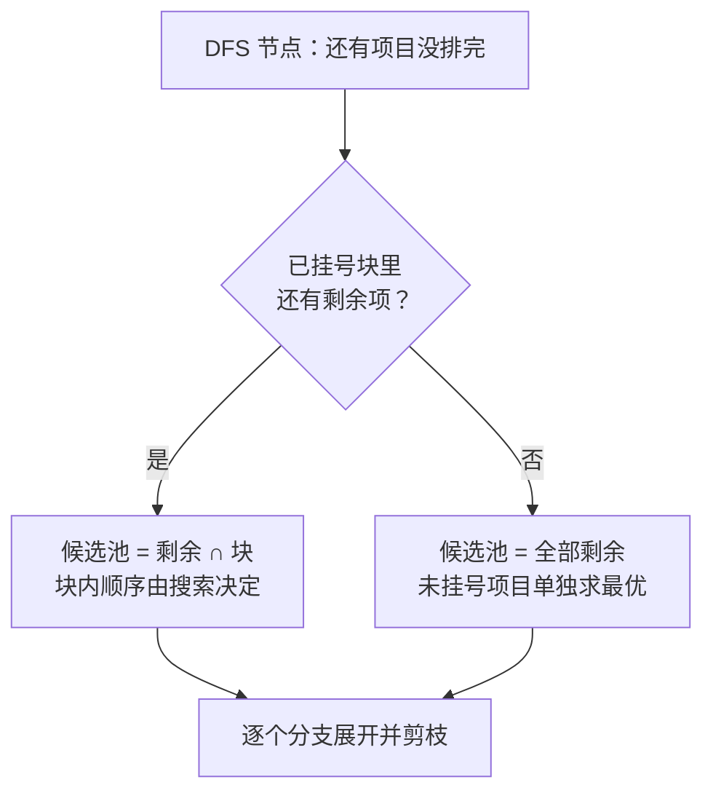
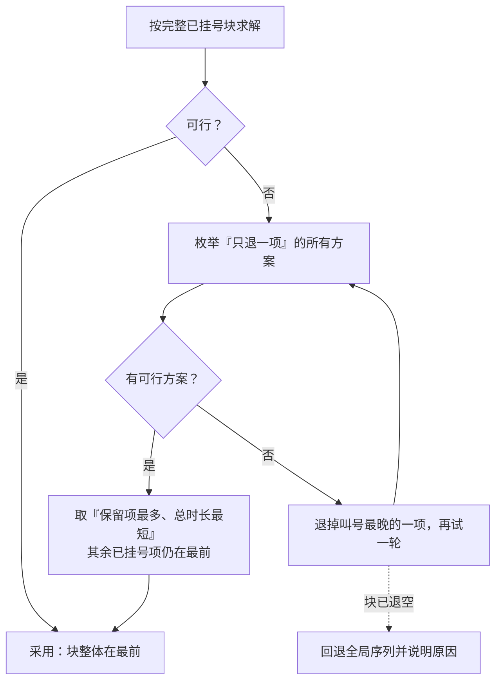

# 调度算法实现说明

> 本文只讲算法：问题怎么建模、搜索怎么做、号（挂号）怎么进入模型、怎么保证结果可信。
> 代码在 `backend/app/`，核心是 `solver.py`（搜索）与 `estimator.py`（等待估算）。

---

## 1. 问题定义

**输入**

| 输入 | 内容 |
|---|---|
| 科室队列快照 | 每科室：排队人数、预计等待 W₀、当前叫号 N、人均服务时长 s |
| 待检项目 | 患者的 N 项检查，每项有科室与服务时长 |
| 耦合规则 | 前置依赖（含报告等待 lag）、时间窗、互斥（`rules.py` 配置） |
| 患者状态 | 已取到的号（项目 → 号码）、已完成项目 |

**输出**：一个执行顺序 + 每步时间线（到达 / 等待 / 开始 / 结束 / 是否过号）。

**目标**：最小化全部检查完成时刻（makespan）。
次要目标依次是：少浪费已取的号、推荐结果不要来回抖动。

---

## 2. 为什么不用现成的求解器

看起来像车间调度（Job Shop），但有一处根本区别：

> **等待时长是"患者到达时刻"的函数，而到达时刻又由执行顺序决定。**

也就是说目标函数依赖它自己的输出。CP-SAT 这类求解器要求把等待写成静态约束或常量，
写不进去；硬要近似就得把时间离散化，误差和建模成本都会上来。

而单患者待检项目通常 3–10 项，合法序列规模在可穷举范围内，所以选了更朴素、但可验证的路线：

```
模拟器在环（模拟真实排队）+ 分支限界（带可采纳下界的深度优先搜索）
```

先用它建立"可信基准"，等真实规模确认后，再决定要不要上时间离散化 + CP-SAT。

---

## 3. 三个基础模型

### 3.1 队列随时间消退

已知此刻加入队列要等 W₀ 分钟，则 t 分钟后到达时：

```
wait(t) = max(0, W₀ − drain · t)      drain = 1.0 默认，0.0 为保守情景
```

为什么成立：设服务台 c 个、单人 s 分钟，则 W₀ = Q·s/c，吞吐 c/s 人/分钟。
t 分钟后队列消化了 t·c/s 人，剩余 Q − t·c/s，此时加入的等待为
(Q − t·c/s)·s/c = W₀ − t —— 与 c、s 的具体取值无关，只与 W₀ 有关。

未取号时展示用 `estimate_wait_at = wait(t) × 1.15`（安全系数，降低过号概率）。

### 3.2 号把开始时刻钉死

```
叫号时刻 call = (我的号 T − 当前叫号 N) × 人均服务时长 s
到达 arrive  = max(上一项结束 + 换科室耗时, 前置结果可用时刻, 开诊时刻)
```

- `arrive ≤ call`：等到 call 再开始，`wait = call − arrive`；
- `arrive > call`：号已过 → 不判"不可行"，转成**现场重新取号排队**（`missed = true`），
  代价是多等一轮，这才符合真实医院的处理方式。

### 3.3 移动与同科室合并

换科室计 `TRAVEL_MINUTES = 4` 分钟；同科室连续两项视为**一次到场**，不重复计移动、
不重复排队（典型：检验科一次采血做血常规 + 生化 + CRP）。

---

## 4. 搜索：分支限界

状态是 `(当前时刻 now, 已完成集合 finish_of, 剩余集合 remaining)`，
每一步枚举"下一项做哪个"，用模拟器算出该步的完整时间线，再递归。

### 4.1 可采纳下界（剪枝的核心）

对剩余项目，完成时刻不可能早于下面三者中的最大值：

```
bound = max(
    now + Σ 剩余服务时长,                     // 服务时间总和
    max_D ( W_D + Σ_{i∈D} s_i ),              // 单科室下界
    max_{有号项} ( call_i + s_i )             // 号的约束
)
```

第二条是关键：同一科室 D 的患者第一次到达时开始时刻 ≥ W_D，之后每项接着做，
所以该科室最后一项完成 ≥ W_D + Σs_i。这个界**不会剪掉最优解**（对拍已验证）。

第一版只用了"服务时长总和"，界太弱（下界 100、实际最优 120），搜索树几乎不剪；
换成科室级下界后，示例算例的搜索节点从 55 降到 18，而且下界常常直接等于最优值，
相当于顺带给出了最优性证书。

### 4.2 探索顺序与终止

- 候选按 `(start, finish)` 排序，先试最早能开始的，尽早拿到一个较好的上界；
- 每个节点用 `lower_bound ≥ 当前最优 + 3 分钟` 剪枝（放宽 3 分钟是为了让"少过号"的
  备选解也能被搜到，见 §5）；
- 时间上限 5 秒、节点上限 200 万，超限返回 `TIME_LIMIT` / `NODE_LIMIT`，
  结果仍可用，只是没有最优性保证。

---

## 5. 三个候选解，选哪个

搜索过程中同时记录三份解：

| 解 | 选法 | 用途 |
|---|---|---|
| `best` | 完成时间最短 | 默认答案 |
| `honor` | 过号数最少；同样少时取更快 | 若比 best 慢 ≤ **3 分钟**（`HONOR_SLACK`），改用 honor —— 多花 3 分钟换回一个号，划算 |
| `alt` | 与上次推荐偏差最小（逆序对最少） | 若总时长在 **1 分钟**（`TIE_WINDOW`）内，沿用旧顺序，避免页面每隔几秒跳一下 |

这三者构成一个很朴素的"多目标"处理：主目标是时间，另外两个目标只在
"几乎不花代价"时才生效。

---

## 6. 号进入模型后的三次升级

这一段是算法迭代的主线，也是最容易踩坑的地方。

### 6.1 第一版：号只影响开始时刻

取号分支让 `start = call`，但顺序仍按全局最优来排。问题：求解器会为了压缩总时长，
把已挂号的项排到号过期之后，患者手里的号白白作废。

### 6.2 第二版：已挂号块作为硬约束

把"已挂号的项目"当成一个**块**，块没做完之前，搜索的候选池只允许从块里挑：

```
if 剩余 ∩ 块 ≠ ∅:  候选池 = 剩余 ∩ 块
else:              候选池 = 剩余
```

这样自然得到两段：块内怎么排由搜索决定（组内仍是最优），块做完才放开其余项目。
块的成员不是"所有取过号的项"，而是"取过号、且前置也在块里"的项（见 6.3 的前置闭包）。



### 6.3 第三版：块排不下时逐项降级

第二版有个副作用：**只要块整体不可行，就整块丢掉**退回全局最优。
典型场景：患者挂了腹部B超的号，但号要 10:41 才叫到，排最前会让肺功能错过 11:00 的时间窗。
整块丢弃的结果是路线完全没变化，用户以为功能没生效。

改成"只退必要的那一项"：



配套的还有**前置闭包** `split_ticket_block`：已挂号项如果依赖一个没挂号的前置
（生化 ← 血常规），把前置拉进块里一起排最前，而不是把已挂号项踢出去——
否则这个号根本用不上（生化要复用那次采血）。

降级以"挂号项"为单位，退掉一项后只为它服务的前置也一并退出块，
避免出现"前置孤零零排最前、挂号项却被挤到后面"。

---

## 7. 性能

| 场景 | 节点数 | 用时 | 状态 |
|---|---|---|---|
| 6 项检查 | 143 | 3.9 ms | OPTIMAL |
| 10 项检查 | 21,777 | 99.9 ms | OPTIMAL |
| 10 项 + 2 个已挂号 | 10,820 | 57.4 ms | OPTIMAL |
| 含时间窗的紧约束 | 数千级 | < 50 ms | OPTIMAL |

最坏仍是 `n!`，但下界剪枝把实际搜索压到了万级节点。10 项以内都在百毫秒级，
远低于 5 秒的时间上限。

---

## 8. 正确性怎么保证

1. **暴力枚举对拍**：120 组随机算例（含随机依赖、随机时间窗），
   求解结果与穷举所有排列的最优值逐一比对，误差必须为 0；
2. **独立模拟器二次验证**：`backend/tests/verify_example.py` 另写一套模拟逻辑，
   按求解结果重放，逐项核对时间与约束，并打印下界证书；
3. **自洽性检查**：用返回顺序重新模拟，总时长必须完全一致（防止搜索状态污染）；
4. **单元测试 21 项**：覆盖依赖、时间窗、缺前置、块前缀穷举最优、前置闸门等。

---

## 9. 代码地图

| 文件 | 职责 | 关键函数 |
|---|---|---|
| `backend/app/solver.py` | 搜索与约束 | `solve()`、`_candidate()`、`lower_bound()`、`simulate()`、`set_ticket_block()` |
| `backend/app/estimator.py` | 等待与叫号 | `wait_at()`、`estimate_wait_at()`、`call_offset()` |
| `backend/app/service.py` | 组装与降级 | `recommend()`、`solve_with_best_block()`、`split_ticket_block()` |
| `backend/app/rules.py` | 项目/依赖/时间窗/参数 | `build_catalog()`、`build_dependencies()`、`build_windows()` |
| `backend/tests/test_solver.py` | 单测与对拍 | 120 组随机算例 |

**算法参数**（`rules.py` 编辑区 3）：

| 参数 | 默认 | 作用 |
|---|---|---|
| `TRAVEL_MINUTES` | 4.0 | 换科室单程耗时 |
| `ESTIMATE_BUFFER` | 1.15 | 估算等待的安全系数 |
| `TIE_WINDOW` | 1.0 | 结果接近时保持推荐稳定 |
| `HONOR_SLACK` | 3.0 | 为保住号允许多花的时间 |
| `SOLVER_TIME_LIMIT` | 5.0 | 单次求解时间上限 |

---

## 10. 实现过程中踩过的坑

| 现象 | 原因 | 修法 |
|---|---|---|
| 早到患者的等待被算多了 | 把"门外等到开诊"算进了排队 | `arrive = max(arrive, 开诊时刻)`，门外等待单独记为 `forced_idle` |
| 剪枝几乎不起作用 | 下界只算了服务时长总和 | 改成科室级下界 `W_D + Σs_i`，节点数下降一个数量级 |
| 无号场景移动耗时失效 | 批量替换只改了有号分支，未取号分支漏改 | 两个分支统一 `arrive = max(now + travel, release)` |
| 取了号页面不更新 | 前端指纹只含顺序和总时长 | 指纹加入 `code:ticket` |
| 挂号后路线完全没变 | 块不可行时整块丢弃 | 逐项降级 + 前置闭包（§6.3） |
| 挂了号反而更慢 | 号把开始时刻钉死，早到只能干等 | 说明里写清"按时到场即可"，并按 `HONOR_SLACK` 权衡是否保号 |

---

## 11. 还能怎么优化

- **同科室强制合并**：未取号时同科室两项仍可能被其他科室插队拆开，可加硬约束；
- **时间离散化 + CP-SAT**：项目数上到 15+ 时，用时段离散化换更稳的求解下限；
- **多患者批量调度**：现在是单患者视角，多患者共享队列时目标会变成"整体吞吐"，
  搜索空间从 n! 变成组合爆炸，需要换成启发式或列生成。
